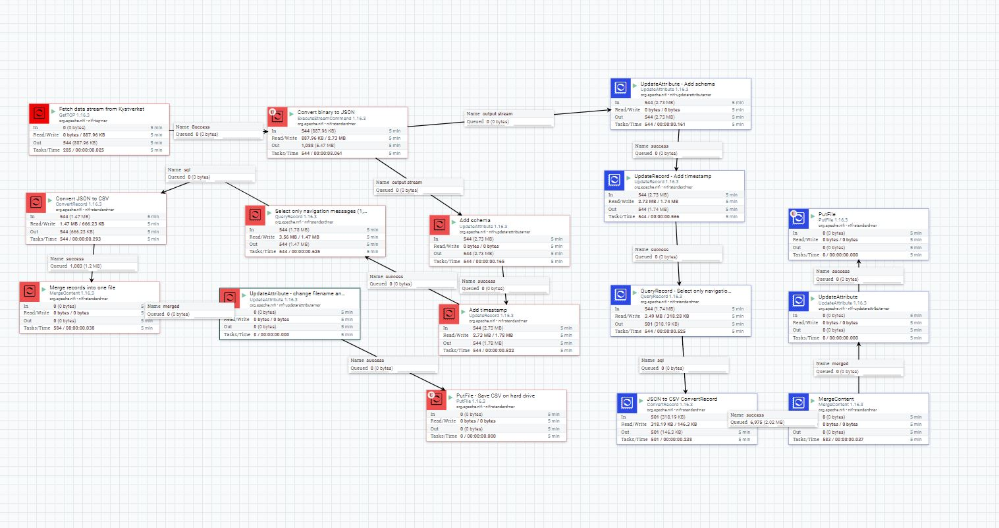

# Datasett
Kan lastes ned [her](https://drive.google.com/file/d/1C5RwRdRgCSQ0EP-kysDz_dI5AcpxKXXP/view?usp=share_link). Datasettet er lastet ned fra Kystverkets åpne datastrøm. Denne datastrømmen har noen begrensninger:
- Gjelder for det geografiske område innenfor norsk økonomisk sone, fiskerivernsonen ved Svalbard og vernesonen ved Jan Mayen.
- Viser ikke fiskefartøy under 15 meter.
- Viser ikke fritidsfartøy under 45 meter.

### Datakvalitet
Datasettet er ikke kontinuerlig men har tre tidsperioder som er mer eller mindre komplette.
- 9 jan - 18 jan 23
- 10 feb -  16 feb 23
- 22 feb - 08 mar 23

I tillegg er det noen timer opprom innen i de ulike periodene som ikke har data.

### Fartøyposisjoner i sanntid

Flow: 

NiFi template: [Template i XML](AIS-lagre-som-CSV-final.xml)

Nifi tilgjengelig her: http://ksing.duckdns.org:8443/nifi/

### Maskinvare
Virtuell maskin etablert i [Google Cloud](https://cloud.google.com/). 

| Machine config  |  |
| ------------- | ------------- |
| Machine type | e2-medium |
| CPU platform | Intel Broadwell  |
| Architecture | x86/64 |
| OS | Ubuntu 20.04 |
| Nifi version | 16.3 |

## Slå sammen til en CSV pr dag
Kjør [dette](create_daily_csv.py) skriptet for å slå sammen og lage en CSV-fil pr døgn. Skriptet leser igjennom alle CSV-filene i mappen (evt endre folder path), sorterer basert på kolonnen 'timestamp_utc' og lagrer nye CSV-filer etter formatet YYYY-MM-DD.

[^1]: https://www.barentswatch.no/artikler/tilbyr-apne-ais-data/
